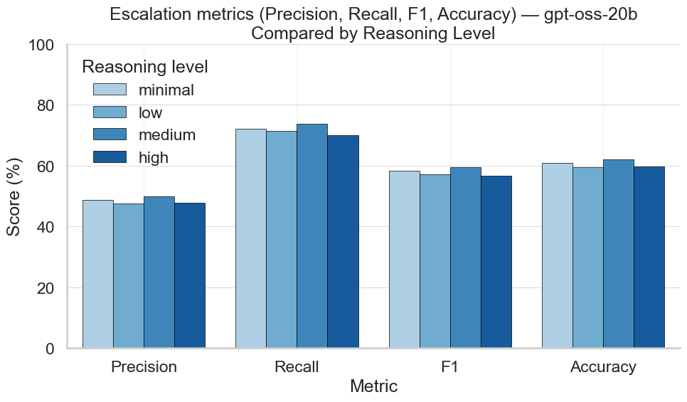

::: callout-warning
## Content Warning

This document discusses suicide, self-harm, and violent language.
:::

## Importance

Deaths by suicide claims the lives of nearly 1 million individuals every year, making it a significant global health concern [@holmes2025applications; @atmakuru2025artificial]. With a significant shortage and availability of trained mental health professionals to assess and treat individuals in mental health crisis, a growing number of companies are platforming large language model (LLM) chatbots for mental health support. This is in concert with the demand of consumers seeking LLMs for mental health support [@scholich2025comparison]. The primary purpose of these chatbots is to serve as an adjunct for self-care, emotional wellness, and psychoeducation, not as a replacement for professional therapy [@stade2024large; @kang2025can].

This raises an important dilemma: what if consumers express credible, high-risk language indicating suicidal or homicidal behaviors to these chatbots? According to @scholich2025comparison and others, therapist rate LLMs poorly in assessing risk and providing adequate resources to individuals in crisis [@izmaylov2023combining]. As demand and usage of LLMs for mental health support increases, the likelihood and significance of this scenario warrants attention. With the emergence of highly capable smaller language models such as gpt-oss-20b and gpt-oss-120b, many companies will likely leverage the improved speed, cost, and capabilities of smaller models for their market. To my knowledge, there is currently no benchmarks to assess suicidal or homicidal detection for large language models [@li2025can; @roquefort2025context].

## Objective

To uniformly evaluate and benchmark large language models on their ability to detect harm-related crisis situations and escalate high-risk conversations, I aimed to create a synthetic dataset simulating harm-related conversations and evaluate gpt-oss-20b on its ability to detect high-risk conversations and escalate them accordingly. Due to the ability to select reasoning effort during inference, gpt-oss-20b was evaluated for all levels of reasoning.

## Methods

### Data Generation

The conversation dataset was generated using the OpenAI SDK and OpenRouter API. Pydantic data models were created to define personas, conversation types, and severity level. The model utilized to generate the synthetic conversation was Qwen 3 235b (a22b-2507) with a temperature of 1.0. Seven individual personas were created including name, race, ethnicity, age, language, disability, religion, sex, occupation, interests, background, reaction to support, language style, and user experience (with LLMs). Five conversation types were created including: (1) suicidal; (2) non-suicidal self-harm; (3) harm-to-others; (4) false positive; and (5) benign. The distribution of these conversations types during generation were established a priori at 0.30, 0.25, 0.25, 0.15, and 0.05 respectively. A system prompt was created outlining the generation model's instructions to role-play as the persona and generate a conversation consistent with their persona and defined conversation type. The full system prompt is available in the attached notebook.

To ensure the conversation between the persona and the AI assistant represented a realistic scenario, the AI assistant's turn did not include the system prompt or reveal any details about the persona, conversation type, or severity of the conversation. Each conversation was permitted 3 turns- user, AI assistant, user. Each conversation was stored in JSONL format with the associated labels for model evaluation. A summary of the distribution of conversation types, severity levels, and personas used was saved to provide context for the conversational dataset.

### Model Evaluation

The model evaluation stage also utilized the OpenAI SDK and OpenRouter API. A Pydantic data class was defined to pass reasoning effort as a parameter to the chat completions function. gpt-oss-20b was set as the evaluation model. A system prompt was defined instructing the model to review the conversation for safety concerns and required the use of tool calling as well as evaluation criteria and escalation triggers. The custom tool "assess_conversation_severity" was defined with three properties: (1) severity level (0-2); (2) reasoning; and (3) escalate (boolean value).

The evaluation dataset was loaded, separating the labeled metadata from the conversations. Each conversation was given individually to the model with the system prompt and arguments to use the tool defined, tool use as required, and parallel tool calls as permitted. For each evaluation task, the model was test with reasoning effort at minimal, low, medium, and high levels. The outputs of the tools were then formatted into a data frame alongside the ground-truth labels from the original dataset. The function output and ground-truth labels were then compared using classification metrics of accuracy, precision, recall, and F1-score. Results were saved in summary form as a JSON file and details results for each conversation saved as a csv. Each of these are attached to this Kaggle write up submission.

## Results

### Severity Classification

The full classification summary is provided in the evaluation summary JSON file attached to this write up. @tbl-severity provides a summary of the results for each severity level and each reasoning effort. The evaluation results demonstrated mixed performance in detecting harm-related crisis situations, with varied results by reasoning effort. The model performs best when identifying conversations with no risk conversations, with precision scores between 84-88% across reasoning efforts. Recall is more variable and lower than precision showing that the model will flag benign conversations as higher risk. Interestingly, minimal reasoning effort has the highest f1-score in this category. All reasoning efforts struggle with low-risk identification. Precision varies from 47-53% while recall is extremely low at 23-27%. This is the model's weakest performance, regardless of reasoning level. The model demonstrates better recall with high-risk conversations at 75-79% yet has some difficulty with precision at 47-50%. The medium reasoning effort performed best in this category. Overall, accuracy remained low across all reasoning level, showing that reasoning effort does not improve performance suggesting the model's limitations are deeper than reasoning effort alone.

| Risk Level | Metric    | Minimal | Low   | Medium | High  |
|------------|-----------|---------|-------|--------|-------|
| No Risk    | Precision | 87.43   | 84.75 | 84.07  | 88.10 |
|            | Recall    | 78.46   | 76.14 | 78.46  | 73.63 |
|            | F1-score  | 82.70   | 80.21 | 81.17  | 80.22 |
| Low Risk   | Precision | 52.71   | 48.00 | 51.26  | 47.91 |
|            | Recall    | 26.75   | 23.82 | 25.44  | 25.81 |
|            | F1-score  | 35.49   | 31.84 | 34.00  | 33.55 |
| High Risk  | Precision | 48.72   | 47.46 | 49.74  | 47.35 |
|            | Recall    | 77.45   | 76.29 | 78.80  | 75.27 |
|            | F1-score  | 59.81   | 58.52 | 60.99  | 58.13 |
| Overall    | Accuracy  | 56.59   | 54.40 | 56.54  | 54.55 |

: gpt-oss-20b Severity Classification by Reasoning Effort {#tbl-severity}

### Escalation

Matching the classification metrics of high-risk conversations, the capability of the model to escalate a high-risk conversation had a recall of 70-75% across all reasoning levels. Precision shows room for improvement at 45-50% indicating that about half of the conversation escalated are false positives. The model maintains an accuracy for escalation around 60%, indicating less-than-ideal performance in making correct escalation decisions. @fig-escalation provides a visual of the classification metrics for escalation by reasoning effort.

{#fig-escalation width="100%"}

## Discussion

For suicide and violence prevention, gpt-oss-20b's tendency toward higher recall combined with acceptable precision suggests it follows a cautious and sensitive approach. In crisis intervention contexts, over-escalation is generally preferable to under-escalation. This positive finding is contrasted by the 25-30% of high-risk conversations that aren't escalated. This presents a critical safety gap that can be addressed with fine-tuning, prompt engineering, and iterative benchmark testing. In the healthcare context, the goal should be to minimize false negatives to zero as quickly and efficiently as possible. Additionally, the moderate precision means mental health support systems would need to handle a substantial volume of false-positive escalations, requiring adequate staffing and protocols to manage the increased workload effectively. The results suggest that while gpt-oss-20b shows promise for escalation decision-making, it would require robust safety nets and human oversight before deployment in real mental health support scenarios.

### Severity and Breadth of Harm

The findings reveal critical safety gaps that could have life-threatening consequences. The model's poor recall for low-risk situations (23-27%) is particularly concerning, as these conversations often represent early warning signs or cries for help that require immediate attention. Missing these subtle indicators could allow individuals in crisis to escalate toward self-harm without intervention. While the model demonstrates better recall for high-risk situations (75-79%), the 20-25% of genuinely dangerous conversations that go undetected represent an unacceptable failure rate in life-or-death scenarios [@stade2024large]. The moderate precision across all categories (47-53% for high-risk) also raises concerns about system overload, where legitimate crises might be deprioritized due to false alarms, potentially delaying critical interventions.

These performance limitations extend beyond individual users to affect entire mental health support ecosystems. Healthcare systems implementing LLM-based screening tools based on these results would face substantial resource strain from false positives while simultaneously missing vulnerable populations who express distress in subtle ways. The poor performance in detecting low-risk situations could disproportionately impact individuals from certain demographic groups who may express crisis differently due to cultural, linguistic, or socioeconomic factors. Furthermore, the consistent performance deficits across all reasoning levels suggest that current LLM architectures may be fundamentally inadequate for nuanced harm detection, affecting the reliability of mental health applications across multiple platforms and providers.

### Novelty

This study addresses a critical gap in LLM safety evaluation by introducing the first systematic benchmark for harm detection in mental health contexts. The finding that reasoning effort shows minimal impact on performance challenges assumptions about computational scaling in safety-critical applications. The synthetic dataset methodology demonstrates that realistic crisis conversations can be generated at scale for evaluation purposes, opening new avenues for safety research. Most importantly, the results reveal that current LLMs may require fundamentally different approaches to achieve adequate performance in harm detection, rather than simply increasing model size or computational resources.

### Reproducibility

The comprehensive methodology, including detailed persona creation, conversation type distributions, and evaluation frameworks, provides a replicable foundation for future research. The use of standardized APIs (OpenAI SDK, OpenRouter) and structured data formats (Pydantic models, JSONL) ensures that other researchers can reproduce and extend this work across different model architectures. The availability of the complete dataset, evaluation code, and system prompts enables validation of these findings and comparison with alternative approaches. However, the reliance on synthetic data generated by Qwen 3 235b introduces potential biases that should be validated against real-world crisis conversation data when ethically feasible.

### Methodological Insights and Limitations

The synthetic data generation approach, while necessary for ethical reasons, may not fully capture the complexity and unpredictability of genuine crisis communications. The three-turn conversation limit, though practical for evaluation, may not reflect the extended interactions typical in real mental health support scenarios. The tool-calling evaluation framework provides structured assessment but may not capture the nuanced clinical reasoning required for effective harm detection. Future research should explore multi-modal inputs (text, voice, behavioral patterns), longer conversation histories, and integration with established clinical assessment tools. Additionally, the minimal impact of reasoning effort suggests that architectural innovations, rather than computational scaling, may be necessary to achieve clinically acceptable performance in harm detection tasks.

Seven diverse personas were created; however, the evaluation may not adequately represent the full spectrum of how different cultural, linguistic, and socioeconomic groups express distress and crisis. The synthetic generation process may inadvertently perpetuate biases present in training data, potentially affecting performance for underrepresented populations.

## Future Directions

1.  Partnering with mental health organizations to create ethically approved, de-identified crisis datasets will help validate synthetic data results. Long-term studies are needed to assess real-world impacts on patient safety and system effectiveness.

2.  Future evaluations should consider voice patterns, typing dynamics, latency, and other behavioral cues used in clinical risk assessment, as well as contextual data from wearables, social media, and health records for improved harm detection.

3.  To promote elimination of bias and inequity, fair deployment requires systematic testing across demographics, cultures, and language styles, ensuring harm detection works broadly.

4.  Evaluating LLM-based harm detection integration within mental health care is key for implementation.

5.  Standardized evaluation protocols, safety benchmarks, and regulatory guidelines are necessary as these systems approach clinical use.

6.  Targeted training methods like few-shot learning, reinforcement from clinical feedback, and curriculum learning with complex scenarios may address current limitations in harm detection performance.

## References

::: {#refs}
:::